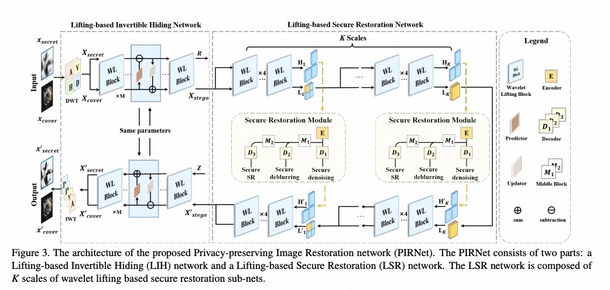

# PIRNet: Privacy-Preserving Image Restoration Network via Wavelet Lifting

[](https://openaccess.thecvf.com/content/ICCV2023/html/Deng_PIRNet_Privacy-Preserving_Image_Restoration_Network_via_Wavelet_Lifting_ICCV_2023_paper.html)
[](LICENSE)

<p align="center">
  <!-- 请将您的主图命名为 pirnet.png 并放在仓库根目录，或者修改下面的 src 路径 -->
  
  <br>
  <em>Figure 1: An illustration of the working process of PIRNet. The low-quality (LQ) secret image is concealed into a stego image, securely restored in the steganographic domain, and finally revealed as a high-quality (HQ) secret image.</em>
</p>

## 📖 Introduction

This is the official PyTorch implementation of the paper **"PIRNet: Privacy-Preserving Image Restoration Network via Wavelet Lifting"**, accepted by **ICCV 2023**.

Cloud-based multimedia services pose serious threats to client privacy. While traditional methods use image encryption, encrypted images look unnatural and are vulnerable to attackers. **PIRNet** proposes a novel approach to operate privacy-preserving image restoration in the **steganographic domain**. 

By leveraging a wavelet Lifting-based Invertible Hiding (LIH) network and a Lifting-based Secure Restoration (LSR) network, PIRNet conceals the secret image into a visually natural stego image. All restoration operations (denoising, deblurring, super-resolution) are performed directly on the stego image without ever revealing the secret content, ensuring both **invisibility** and **security**.

## 🛠️ Environment Setup

This project was developed and tested with the following environment:

- **Python**: 3.8+
- **PyTorch**: 1.10+ (Recommended 2.0+)
- **CUDA**: 11.3+
- **Hardware**: Trained on NVIDIA RTX 3090 GPU

We recommend using `conda` to set up the environment:

```bash
conda create -n pirnet python=3.8
conda activate pirnet
pip install torch torchvision torchaudio --index-url https://download.pytorch.org/whl/cu118
pip install opencv-python numpy scipy lpips tqdm
```

## 📦 Datasets

We adopt the **DIV2K** dataset for training and testing (800 images for training, 100 for testing). 
- You can download the DIV2K dataset from the [official website](https://data.vision.ee.ethz.ch/cvl/DIV2K/).
- During training, Gaussian noise ($\sigma \in [0, 55]$), Gaussian blur (kernel size $\in [3, 25]$), and bicubic downsampling ($2\times, 4\times$) are applied to generate degraded secret images.

*Please update the dataset paths in the configuration or shell scripts before running.*

## 🚀 Getting Started

### Repository Structure
The core modules of PIRNet are organized as follows:
- `LIH.py`: Lifting-based Invertible Hiding network.
- `LSR.py`: Lifting-based Secure Restoration network.
- `SRM.py`: Secure Restoration Module (multi-task decoder).
- `datasets.py`: Data loading and degradation pipelines.
- `losses.py`: Hiding loss and Secure restoration loss implementations.
- `train_LIH.py` / `train_LSR.py`: Training scripts for the multi-stage training strategy.
- `testlpips.py`: Evaluation script using LPIPS, PSNR, and SSIM metrics.

### Training

PIRNet uses a multi-stage training procedure:
1. **Stage 1**: Train the LIH network with the hiding loss.
2. **Stage 2**: Freeze LIH and train the LSR network via the secure restoration loss.
3. **Stage 3**: Fine-tune the whole network end-to-end.

To train the **LIH** network:
```bash
python train_LIH.py --config [path_to_config]
# Or if a shell script is provided in your local setup:
# bash train_LIH.sh
```

To train the **LSR** network:
```bash
python train_LSR.py --config [path_to_config]
# Or if a shell script is provided in your local setup:
# bash train_LSR.sh
```

### Testing & Evaluation

To evaluate the trained models (Denoising, Deblurring, Super-Resolution) and compute PSNR, SSIM, and LPIPS metrics:

```bash
python testlpips.py --checkpoint [path_to_checkpoint] --task [denoise/deblur/sr]
```

## 📊 Performance

PIRNet achieves state-of-the-art performance compared to existing pipelines (combinations of SOTA hiding and restoration networks like HiDDeN+NAFNet, DeepMIH+MIRNetv2, etc.) on DIV2K.

| Task | Metric | Stego Image ($x'_{stego}/x_{cover}$) | Secret Image ($x'_{secret}/x_{gt}$) |
| :--- | :--- | :--- | :--- |
| **Denoising** ($\sigma=25$) | PSNR / SSIM | **29.39** / **0.9775** | **29.21** / **0.9556** |
| **Deblurring** (Kernel=15) | PSNR / SSIM | **30.12** / **0.9851** | **28.73** / **0.9701** |
| **Super-Resolution** ($4\times$)| PSNR / SSIM | **30.33** / **0.9863** | **24.51** / **0.9017** |

## 📚 Citation

If you find this work useful in your research, please consider citing our ICCV 2023 paper:

```bibtex
@inproceedings{deng2023pirnet,
  title={PIRNet: Privacy-preserving image restoration network via wavelet lifting},
  author={Deng, Xin and Gao, Chao and Xu, Mai},
  booktitle={2023 IEEE/CVF International Conference on Computer Vision (ICCV)},
  pages={22311--22320},
  year={2023},
  organization={IEEE}
}
```

## 🙏 Acknowledgements

This work is supported by the National Natural Science Foundation of China under Grants 62001016, 62231002, 62250001, and the Young Elite Scientists Sponsorship Program 2022QNRC001 by CAST.

We also thank the authors of [HiNet](https://github.com/MaureenZOU/HiNet), [NAFNet](https://github.com/megvii-research/NAFNet), and [DeepMIH](https://github.com/JustinGuan/DeepMIH) for their open-source contributions.

## 📄 License

This project is licensed under the MIT License. See the [LICENSE](LICENSE) file for details.
```
